# Lab 3: REST API, Query Parameters, Validation & Debugging

## Project Information

**Subject:** Backend Development Fundamentals  
**Lab:** Lab 3  
**Year:** II  
**Term:** II  
**Student Name:** Bhuvanesh Damera

## Project Description

This project implements a RESTful API using Node.js, Express.js and SQLite. It demonstrates CRUD operations, query parameters, searching, sorting, pagination, price filtering, input validation and error handling.

## Technologies Used

- Node.js
- Express.js
- SQLite
- JavaScript
- Postman
- GitHub
- Render (Deployment)

## Project Links

**GitHub Repository:**  
[https://github.com/Manu-Hub330/Bhuvanesh-BDF-LAB-3](https://github.com/Manu-Hub330/Bhuvanesh-BDF-LAB-3)

**Live Deployment:**  
[https://bhuvanesh-bdf-lab-3-2.onrender.com](https://bhuvanesh-bdf-lab-3-2.onrender.com)

## API Testing Screenshots

All API endpoints were tested using Postman. The following screenshots demonstrate the functionality and expected responses.

### 1. GET Requests

**Screenshot 01 – Get All Books**

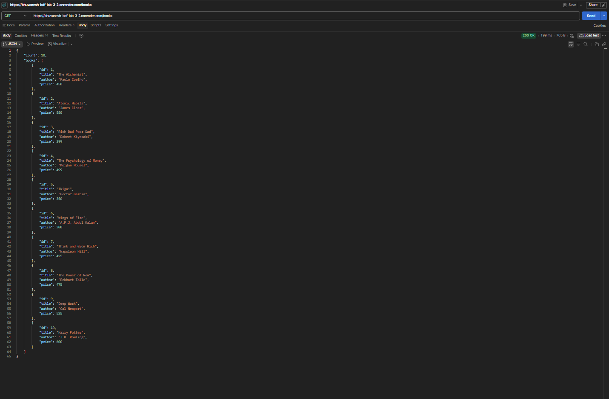

**Screenshot 02 – Search Books**

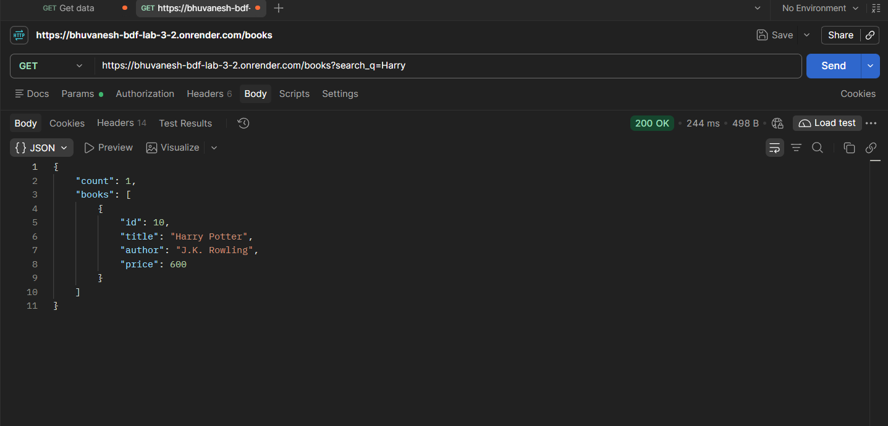

**Screenshot 03 – Sort Books in Ascending Order**

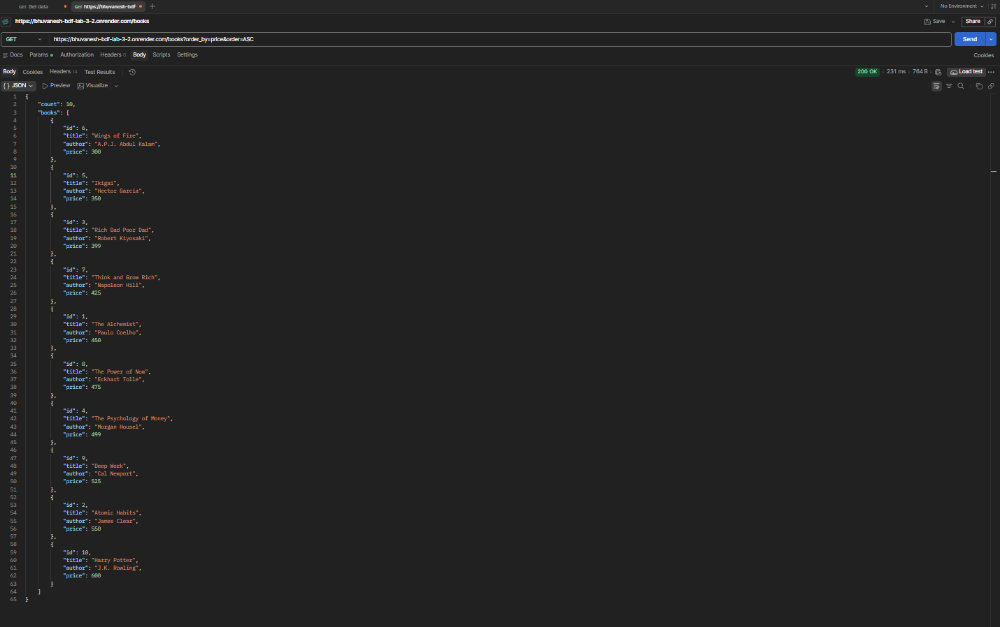

**Screenshot 04 – Sort Books in Descending Order**

**Screenshot 05 – Pagination (First Page)**

**Screenshot 06 – Pagination (Second Page)**

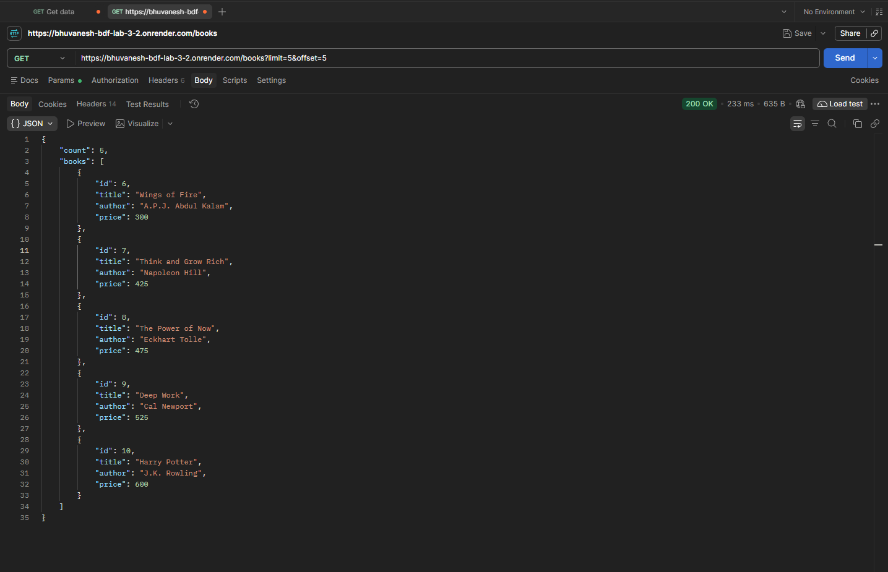

**Screenshot 07 – Filter Books by Price Range**

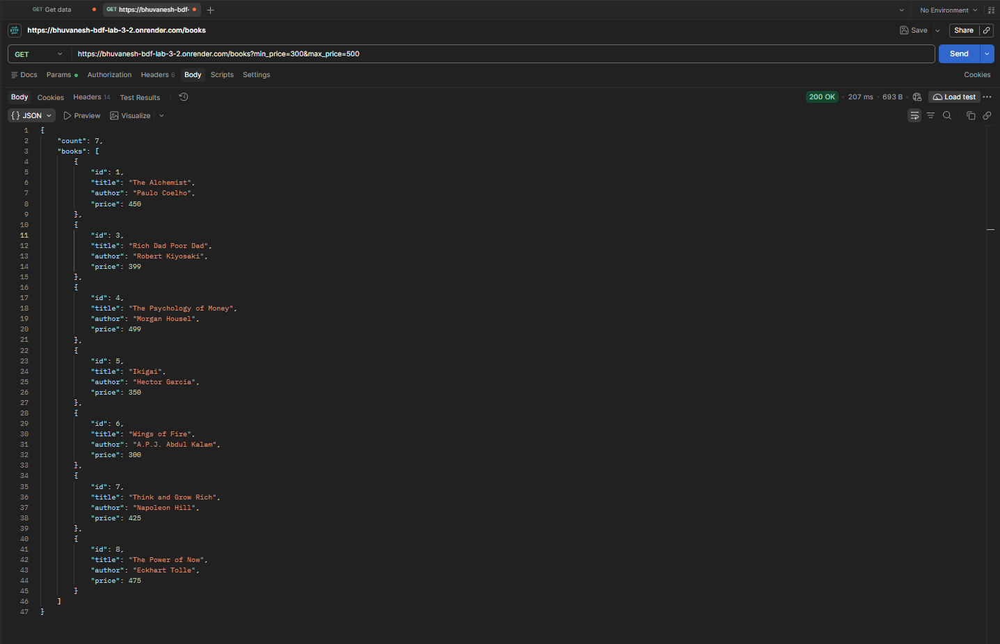

**Screenshot 08 – Get Book by ID**

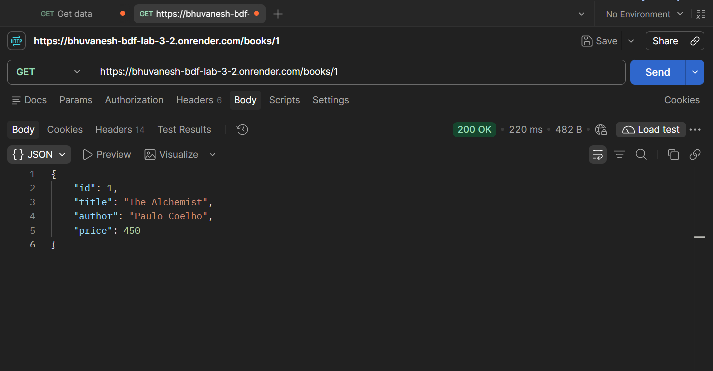

### 2. POST Requests – Create and Validation

**Screenshot 09 – Add a New Book Successfully**

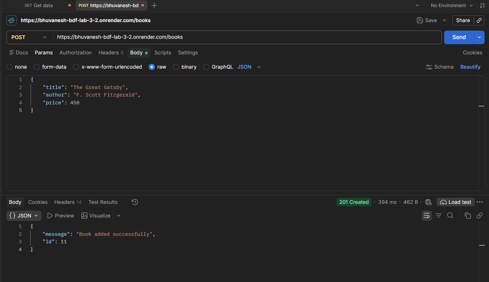

**Screenshot 10 – Validation Error for Missing Fields**

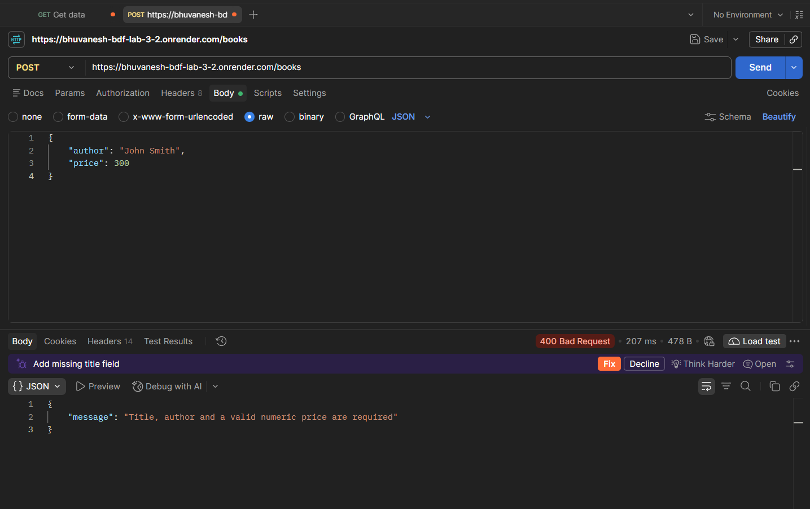

**Screenshot 11 – Validation Error for Invalid Price**

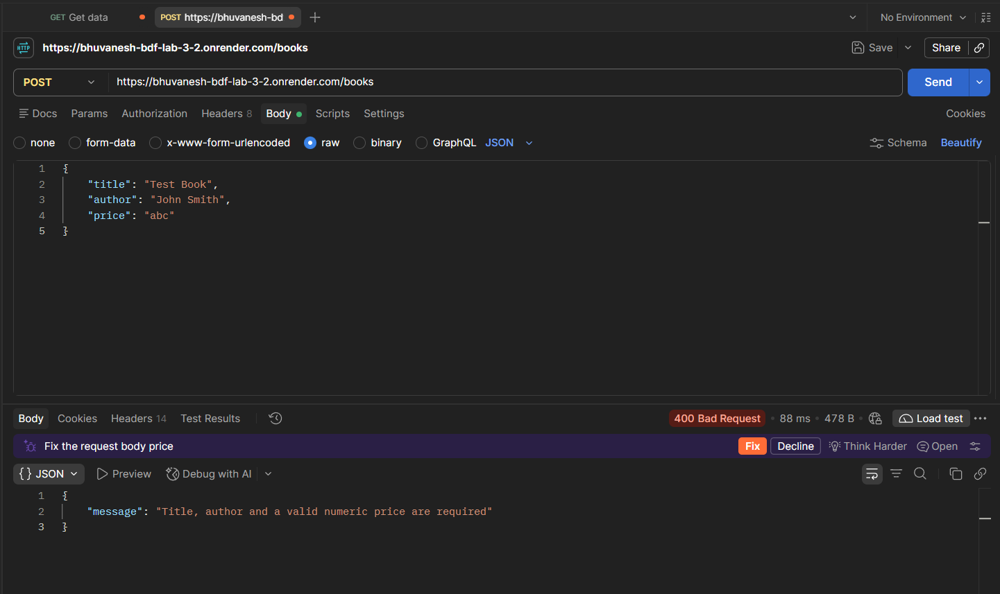

### 3. PUT Requests – Update

**Screenshot 12 – Update an Existing Book**

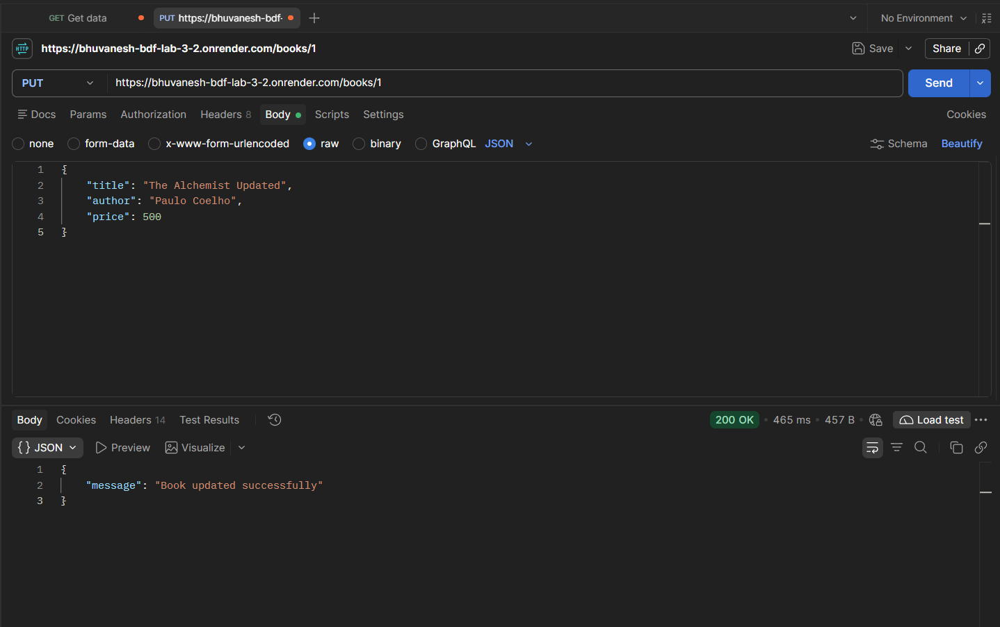

**Screenshot 13 – Update a Non-Existing Book**

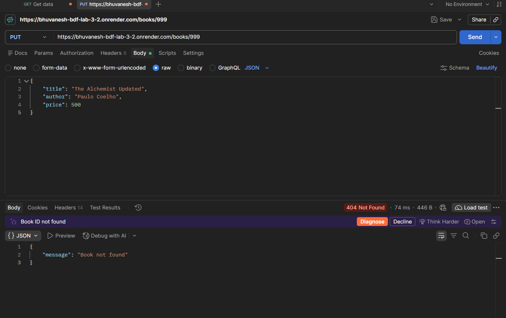

### 4. DELETE Requests

**Screenshot 14 – Delete an Existing Book**

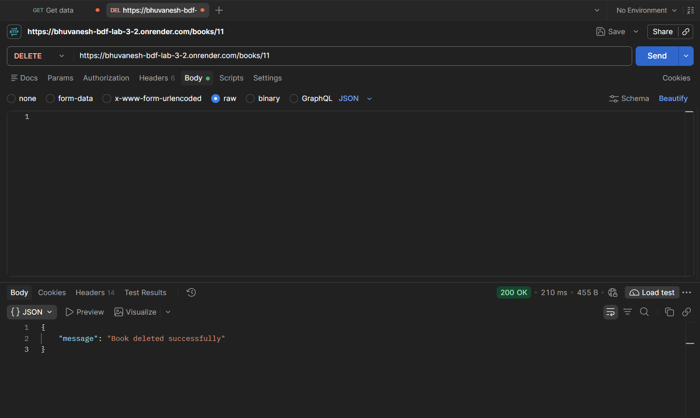

**Screenshot 15 – Delete a Non-Existing Book**

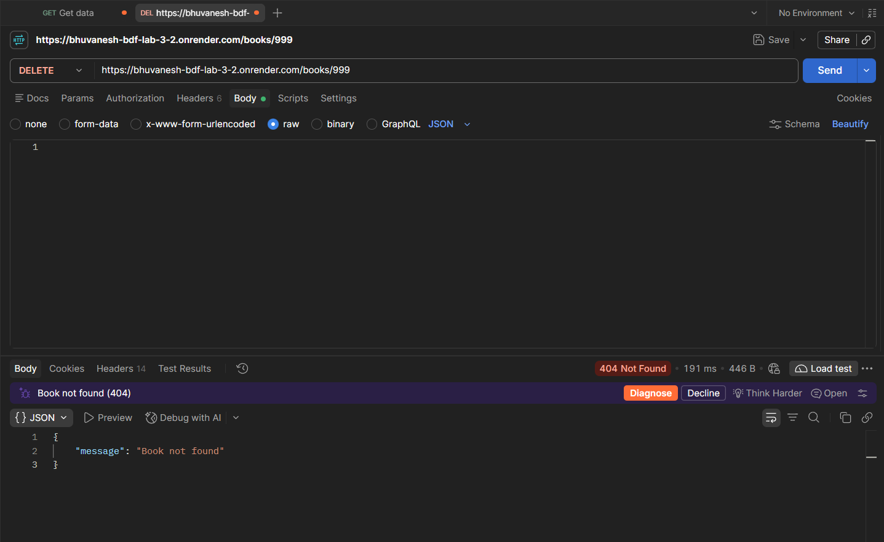

### 5. Additional Error Testing

**Screenshot 16 – Invalid Sorting Parameter**

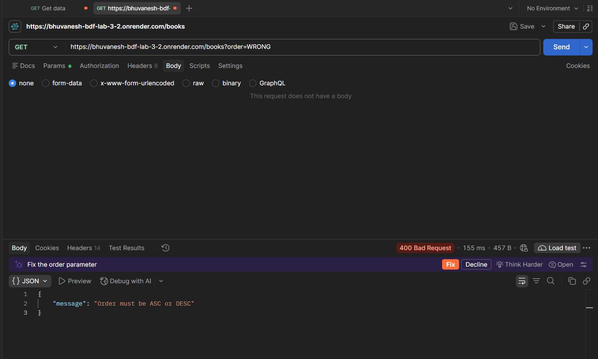

**Screenshot 17 – Invalid Book ID**

## Debugging Exercises

The project also covers the following debugging scenarios:

1. **EADDRINUSE:** Identifying and resolving port conflicts.
2. **Wrong Import Path:** Correcting incorrect module import paths.
3. **No Such Table:** Identifying and fixing SQLite table name errors.
4. **Missing Await:** Correcting asynchronous operations by using the await keyword.

## Features Implemented

- Retrieve all books.
- Search books using query parameters.
- Sort books by price.
- Implement pagination using limit and offset.
- Filter books using minimum and maximum prices.
- Retrieve individual books using their IDs.
- Add new books using POST.
- Update existing books using PUT.
- Delete books using DELETE.
- Validate incoming request data.
- Handle invalid requests and missing records.
- Debug common backend development errors.

## Conclusion

This project demonstrates the practical implementation of REST API development using Node.js, Express.js and SQLite. It provides experience in handling HTTP methods, query parameters, CRUD operations, validation, error handling, database interactions and debugging. All implemented API functionalities were tested using Postman and the application was deployed online.